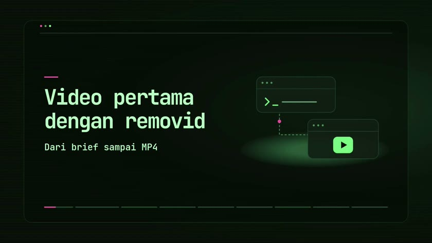
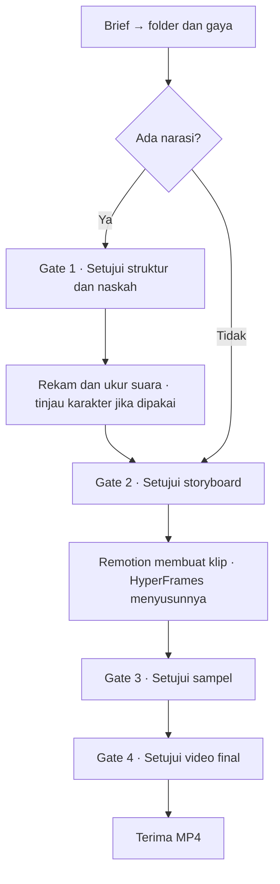
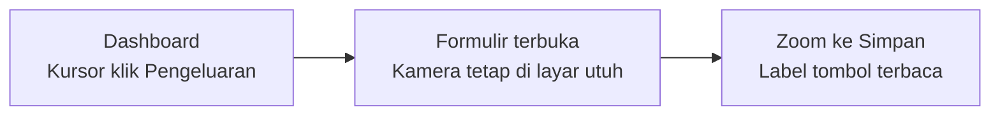

# Video pertama dengan removid

Ikuti satu contoh dari brief sampai MP4. Di setiap tahap, Anda bisa melihat apa yang dibuat agen, apa yang perlu Anda periksa, dan bagaimana meminta revisi.

## Tonton video panduan

[](media/panduan-removid.mp4?raw=true)

[Tonton atau unduh MP4](media/panduan-removid.mp4?raw=true) · 45 detik · 1080p · 60 fps

## Alur proyek

**Remotion** membuat adegan, termasuk gerakan kursor, zoom, dan karakter. **HyperFrames** menyusun klip adegan, memotong footage, memasang transisi, mencampur suara, dan merender video akhir. Setelan bawaan video adalah **60 fps**.



## 1. Mulai dengan brief yang bisa langsung dipakai

Pasang skill dari repositori dengan `./install.sh`, lalu buka ulang sesi agen. Di Claude Code, mulai dengan `/removid`. Di Codex, gunakan `$removid`. Di Antigravity, tulis permintaan dalam bahasa sehari-hari dan sebut nama `removid`. Gunakan `doctor` sebagai argumen untuk memeriksa perangkat yang diperlukan, misalnya `/removid doctor`.

Contoh brief untuk latihan ini memakai aplikasi fiktif bernama Catat. Saat membuat video sendiri, ganti nama, langkah, dan tangkapan layar dengan milik proyek Anda.

```text
/removid Buat tutorial UI 30 detik untuk Reels. Pakai gaya flatlife, narasi
bahasa Indonesia dari rekaman saya tanpa karakter, dan layar dari tangkapan
dashboard aplikasi Catat. Tunjukkan kursor membuka menu Pengeluaran, lalu
zoom ke tombol Simpan. Tambahkan efek klik. Tujuannya agar pengguna baru
tahu cara mencatat pengeluaran.
```

Sertakan tujuan, penonton, format, serta aset yang sudah tersedia. Dari brief contoh, agen sudah tahu formatnya vertikal, durasinya 30 detik, gaya yang dipakai `flatlife`, dan suara akan berasal dari rekaman Anda. Agen menanyakan pilihan teknis yang masih terbuka, seperti keperluan caption atau musik latar. Kirim tangkapan layar yang memperlihatkan menu dan tombol sesuai langkah yang ingin diajarkan. Setelah folder dibuat, aset tersebut masuk `Asset/owner/` dan dicatat di `Asset/ASSETS.md`. [Cara kerja intake](intake.md)

## 2. Setujui cara videonya bercerita dan apa yang akan diucapkan

Pada **Gate 1**, agen menampilkan tabel struktur dan blok naskah narasi. Struktur di `Storyboard/STRUCTURE.md` menyimpan urutan gagasan, apa yang terlihat, dan jatah waktu tiap bagian. `Storyboard/SCRIPT.md` berisi paragraf ucapan yang diawali tag emosi, misalnya `[curious] Mau mencatat pengeluaran hari ini?` Agen menghitung apakah kalimat muat di jatah waktu yang ditetapkan.

Dalam contoh Catat, periksa apakah menu **Pengeluaran** dikenalkan sebelum tombol **Simpan** dan apakah istilah dalam naskah cocok dengan layar. Bila sudah sesuai, balas dengan persetujuan atas struktur dan naskah. Bila perlu revisi, sebutkan bagian dan penggantinya.

> Di bagian pembuka, ganti “mengatur anggaran” dengan “mencatat pengeluaran” supaya tujuan tutorial langsung jelas.

Setelah Gate 1 disetujui, rekam naskah. Anda bisa mengirim satu file per paragraf atau satu rekaman utuh dengan jeda minimal setengah detik antarparagraf. Agen mengukur durasi dari file itu. Jika Anda memilih suara agen, tag emosi memandu penyampaiannya. Jika brief juga meminta karakter narator, agen memperlihatkan rancangan karakter dan ekspresinya sebelum storyboard. [Panduan suara dan emosi](emotion-and-voice.md)

## 3. Periksa apa yang terjadi di layar

Pada **Gate 2**, agen menjelaskan `Storyboard/STORYBOARD.md` per adegan. Anda bisa mencocokkan ucapan dengan teks, aksi kursor, zoom, dan transisi. Waktu ucapan mengikuti hasil pengukuran rekaman. Setelah pemeriksaan lolos, removid menulis `Storyboard/plan.json` sebagai acuan jumlah frame untuk render.

Untuk Catat, periksa apakah ujung kursor sampai di menu **Pengeluaran**, apakah zoom dimulai setelah klik, dan apakah tombol **Simpan** terbaca saat dibahas.



Kalau perlu, balas dengan instruksi seperti ini.

> Pertahankan layar penuh saat kursor mengklik Pengeluaran. Setelah formulir terbuka, baru perbesar area tombol Simpan.

Agen mulai membuat adegan dan klip setelah Anda menyetujui storyboard. [Panduan storyboard](storyboard.md)

## 4. Tonton sampel, lalu periksa hasil akhir

- **Gate 3 · Sampel.** Tonton cuplikan sekitar 10 detik di `Result/sample/`. Periksa apakah pembuka mudah dipahami, suara jelas, dan gerakan kursor terasa wajar. Untuk revisi, sebutkan waktu dan masalahnya, misalnya “Di detik 7, efek klik menutupi narasi. Tolong kecilkan efeknya.” Render penuh dimulai setelah sampel disetujui.
- **Gate 4 · Final.** Periksa seluruh MP4 di `Result/v1/` untuk versi pertama. Agen melaporkan durasi, resolusi, fps, dan hasil pemeriksaan audio. Putar video pada perangkat yang akan Anda pakai dan periksa kembali langkah terakhir serta keterbacaan layar. Setelah Anda setuju, agen menyelesaikan penyerahan.

## Pilih alur sesuai bahan yang Anda punya

| Kebutuhan | Yang perlu disiapkan |
| --- | --- |
| Motion graphics singkat dengan teks, musik, dan efek | Tulis pesan utama dan format. Jika proyek tanpa narasi berdurasi maksimal 45 detik serta memenuhi batas fitur, agen dapat memakai [kit FAST](../fast/FAST.md). Untuk video tanpa narasi, struktur diperiksa di Gate 2. |
| Edit dari klip yang sudah direkam | Sediakan footage dan sebutkan bagian tiap klip yang ingin dipakai. Folder footage adalah `Raw-Footage/`. [Alur penyuntingan](hyperframes.md) |
| Video dengan karakter narator atau demo UI | Sertakan preferensi karakter atau tangkapan layar dan aksi yang ingin ditunjukkan. Agen memakai starter penuh. [Karakter](character-and-narration.md) · [Kursor dan kamera](cursor-and-camera.md) |

## Lanjutkan proyek atau minta revisi

Di sesi baru, sebutkan path folder yang berisi `PROJECT.md` dan apa yang ingin dilanjutkan. Contoh bentuk path `Project-Motion/Catat/<YYYYMMDD>-tutorial-pengeluaran/`. Agen membaca `PROJECT.md` dan menjalankan `status` untuk melihat gate terakhir serta langkah berikutnya.

| Yang terlihat | Cara melanjutkan |
| --- | --- |
| `waiting` | Tinjau artefak yang diajukan. Beri persetujuan atau tulis bagian yang ingin diperbaiki. |
| `stale` | Tinjau versi terbaru. Perubahan pada materi yang sudah disetujui, seperti kata dalam naskah atau waktu di storyboard, meminta persetujuan ulang dari gate yang terdampak. |
| `FOLDER INCOMPLETE` | Minta agen menjalankan `repair` pada folder proyek untuk membuat kembali folder dan berkas wajib yang hilang. |
| Render gagal atau berkas akhir kurang sesuai | Sertakan pesan error atau nama file, waktu kejadian, dan perilaku yang Anda harapkan. Agen memeriksa tahap terkait mulai dari folder proyek. |

Untuk menjalankan sendiri, ikuti [alur teknis](workflow.md) dan [referensi perintah serta gate](project-folder.md).
